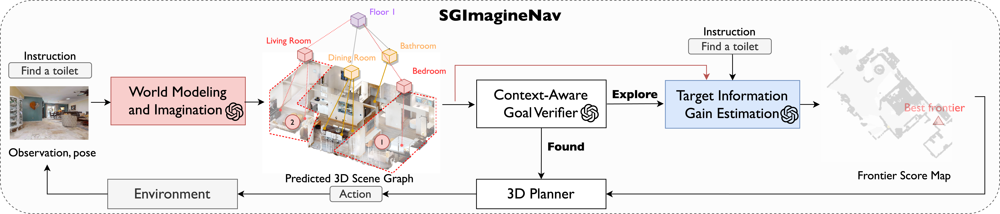

# Imaginative World Modeling with Scene Graphs for Embodied Agent Navigation

**Accepted by IEEE Robotics and Automation Letters (RA-L), 2026.**

[Paper](https://arxiv.org/abs/2508.06990) · [Video](https://www.youtube.com/watch?v=zwx96VJfb2A)

SGImagineNav helps an agent find objects in unfamiliar environments by reasoning about what it has seen and what might lie beyond its current view. We use hierarchical scene graphs to represent the environment and predict where to explore next.

This repository contains the code and experiment configurations for the HM3D ObjectNav experiments.



## Installation

You can install SGImagineNav locally or use Docker. Both use **Python 3.10.17, PyTorch 2.7.1, CUDA 12.8 and Habitat 0.3.3** on Linux with an NVIDIA GPU (Ampere or newer).

```bash
git clone https://github.com/UMich-CURLY/SGImagineNav.git
cd SGImagineNav
```

### Local installation

Start with a Conda environment:

```bash
conda create -n sg_vln -c conda-forge python=3.10.17 pip=25.0.1 -y
conda activate sg_vln
```

Follow the [local installation guide](docs/installation.md) to install CUDA, the Python dependencies, Habitat, PyTorch3D, GroundingDINO/SAM and Ollama. The guide includes the build commands and model downloads for this environment.

### Docker

With Docker and [NVIDIA Container Toolkit](https://docs.nvidia.com/datacenter/cloud-native/container-toolkit/latest/install-guide.html) installed, build the image:

```bash
bash docker/build.sh
```

The image includes the dependencies and GroundingDINO/SAM checkpoints. See [the Docker guide](docker/README.md) for container details.

## Prepare the dataset

Our experiments use the [HM3D validation scenes with semantic annotations](https://aihabitat.org/datasets/hm3d/) and [HM3D ObjectNav v1 episodes](https://dl.fbaipublicfiles.com/habitat/data/datasets/objectnav/hm3d/v1/objectnav_hm3d_v1.zip). Download both and arrange them like this:

```text
datasets/
  hm3d/
    hm3d_annotated_basis.scene_dataset_config.json
    val/
  objectnav_hm3d_v1/
    val/val.json.gz
    val/content/
```

## Run evaluation

The default experiment uses GPT-4o-mini for scene descriptions and predictions. Copy the settings template, then fill in your dataset directory and OpenAI API key:

```bash
cp .env.example .env
```

In `.env`, `DATASET_ROOT` is the directory containing `hm3d/` and `objectnav_hm3d_v1/`.

**For a local installation**, activate your environment and link the datasets from the repository root:

```bash
conda activate sg_vln
export GSA_PATH="$PWD/third_party/Grounded-Segment-Anything"
export PATH="$PWD/third_party/ollama/bin:$PATH"
export YOLO_CONFIG_DIR="$PWD/third_party/ultralytics"
set -a
source .env
set +a
bash scripts/setup_dataset.sh "$DATASET_ROOT/hm3d" "$DATASET_ROOT/objectnav_hm3d_v1"
```

**For Docker**, open the container:

```bash
bash docker/start.sh
```

Then link the datasets inside it:

```bash
bash scripts/setup_dataset.sh /datasets/hm3d /datasets/objectnav_hm3d_v1
```

Once the data is linked, run the same evaluation command in either environment:

```bash
bash experiments/run_exp.sh hm3d_prediction \
  Utility_ObjectRegion_ExploitationOnly_Prediction.yaml \
  1 1 0 all false
```

This runs the full validation set on GPU 0. The first run also downloads the CLIP weights. You'll find results, logs and videos in `dump/hm3d_prediction/objectnav-dino/`.

To try a single episode first, replace `all` with a label such as `4ok3usBNeis_0`. Runs resume from existing results; change `hm3d_prediction` to a new name when you want a fresh run.

The other experiment configurations are in [`exp_configs/`](exp_configs/). You can also run `python main_vis_multi.py --help` to see the evaluator options.

## Citation

If you use SGImagineNav in your research, please cite our paper:

```bibtex
@article{hu2025imaginative,
  title={Imaginative World Modeling with Scene Graphs for Embodied Agent Navigation},
  author={Hu, Yue and Wu, Junzhe and Xu, Ruihan and Liu, Hang and Xi, Avery and Liu, Henry X. and Vasudevan, Ram and Ghaffari, Maani},
  journal={arXiv preprint arXiv:2508.06990},
  year={2025}
}
```

## Acknowledgements

We thank the authors of [ConceptGraphs](https://github.com/concept-graphs/concept-graphs), [L3MVN](https://sites.google.com/view/l3mvn), [VLN-Game](https://github.com/ybgdgh/VLN-Game), [Habitat](https://github.com/facebookresearch/habitat-lab) and [Grounded Segment Anything](https://github.com/IDEA-Research/Grounded-Segment-Anything) for sharing the work this implementation builds on.
